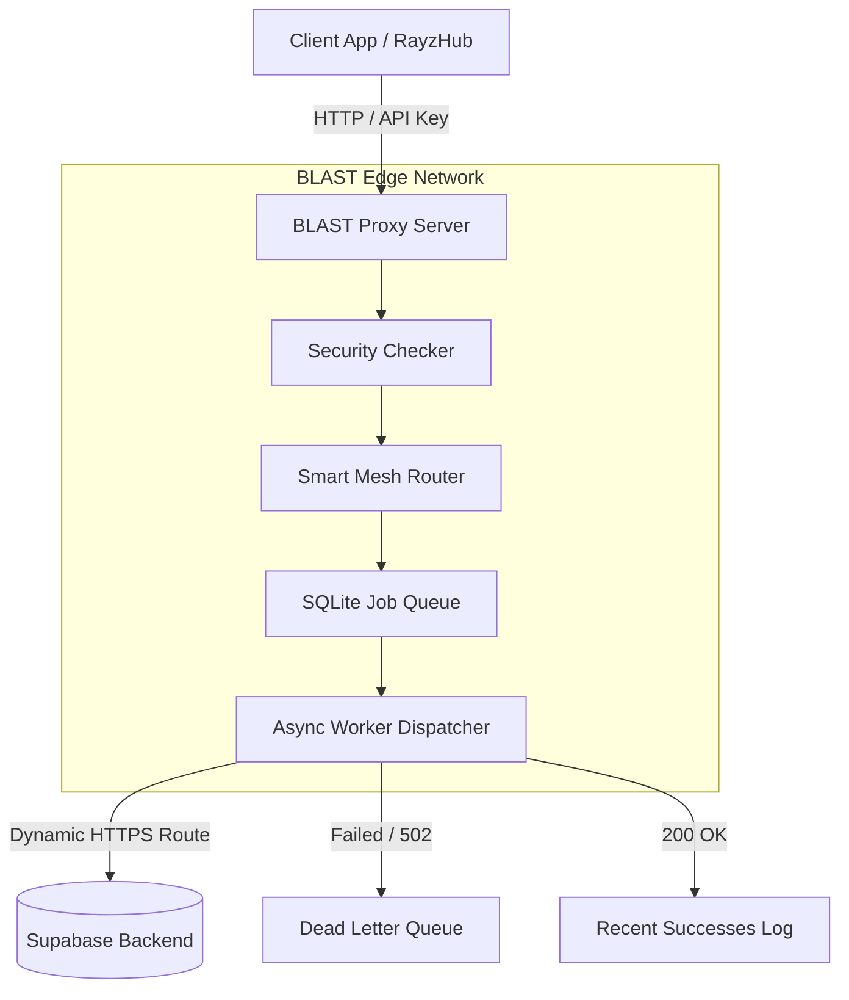

# B.L.A.S.T. Gateway (Backend Logic & Automated Security Tunnel)

BLAST is a high-performance, asynchronous edge gateway designed to protect, route, and queue requests to your Supabase backend. It features smart mesh routing, dead letter queues (DLQ), automated background worker maintenance, and dynamic credential management.

---

## [I] Architecture Overview



---

## [II] Quick Start Guide

### 1. Installation
Clone the repository and install the dependencies:
```bash
git clone https://github.com/your-username/BLAST.git
cd BLAST
pip install -r requirements.txt
```

### 2. Configuration (`settings.json`)
BLAST securely manages your credentials using `settings.json` (persisted securely).
Make sure your `settings.json` matches this structure:

```json
{
  "supabase_url": "https://wroxiurfsjvfsonrqdyn.supabase.co",
  "supabase_anon_key": "ylYrX1pIJhz_mIsoCP4_VA_ysrZQvVU",
  "blast_api_key_1": "blast-secret-key-1",
  "blast_api_key_2": "blast-dev-key",
  "blast_cluster_secrets": ["blast-cluster-mesh-secret-key"]
}
```
*Note: The `supabase_anon_key` should NOT include the `sb_publishable_` prefix in the JSON file. BLAST automatically prepends it in memory to prevent GitHub Secret Scanning bots from automatically revoking your credentials on public repos.*

### 3. Running the Server
Start the server using Python:
```bash
python main.py
```
The Gateway GUI will be available at `http://localhost:8080/gui`.

---

## [III] Connecting Apps (RayzHub)

To route your app (e.g., RayzHub) through BLAST, simply replace your direct Supabase URL with your deployed BLAST URL.

* **Target URL**: `https://your-blast-server.onrender.com`
* **Headers**: You must include your BLAST API key in the headers.

```javascript
// Example Client Request
fetch('https://your-blast-server.onrender.com/rest/v1/users', {
    method: 'GET',
    headers: {
        'X-Blast-Key': 'blast-secret-key-1', // Your custom API Key
        'Content-Type': 'application/json'
    }
});
```

---

## [IV] Web Dashboard & Monitoring

BLAST comes with a fully built-in GUI for real-time monitoring and configuration. Access it by navigating to `/gui` on your server.

### [+] Dashboard
Monitor live requests, queue depth, mesh active nodes, and background worker status.

### [+] Failed Jobs (DLQ)
If a request fails (e.g., Supabase throws a 502 or 429), it is automatically placed in the Dead Letter Queue. You can inspect the failure reason and manually click **[RETRY]** once the backend recovers.

### [+] Success Jobs
View the 50-most recent successful (HTTP 2xx) requests. This is the fastest way to verify that your app is successfully communicating through the proxy to Supabase.

### [+] Server Network (Cluster Mesh)
The **Common Credential Link System** (Cluster Mesh) allows multiple BLAST servers to communicate and distribute load. 
1. Enter your `blast_cluster_secrets` in the Settings tab. 
2. Any BLAST server that shares this secret can route traffic to each other.
3. The Smart Mesh Router will automatically select the server with the lowest latency and queue depth.

---

## [V] Persistent Logs & Data

All databases and logs are strictly isolated to the `logs/` directory, making backups and persistence across ephemeral deployments (like Render free tiers) incredibly easy:

* `logs/blast_queue.db`: SQLite database holding your active queue, DLQ, and mesh nodes.
* `logs/blast.log`: Raw append-only logs for external ingestion.
* `logs/settings.json`: Synchronized configurations from the Web GUI.

---
**Build passing | Mesh Routing Active | Background Workers Engaged**
